# CAN 3D Prostate Segmentation Model [hard difficulty]

Author: s5048803

| Model | Params | Prostate Dice | Mean fg Dice | Inference / volume |
| ----- | ------ | ------------- | ------------ | ------------------ |
| CAN2D | 21,222 | 0.828         | 0.897        | 94.5 ms            |
| CAN3D | 63,126 | 0.864         | 0.890        | 935.5 ms           |

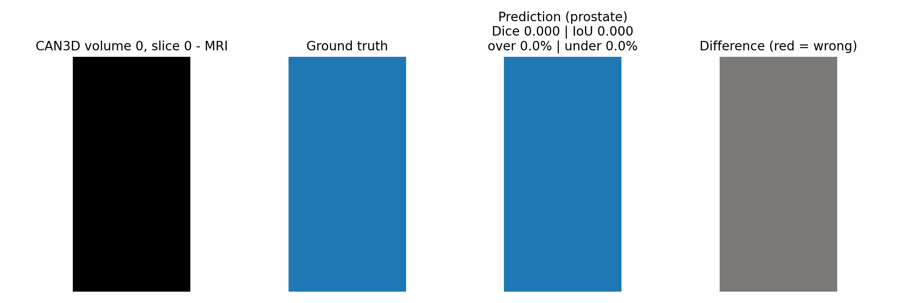

## Folder structure

```Folder-Structure
CAN3D_s5048803/
├── dataset.py				-> Dataloading / split train, validate & test equally
├── modules.py				-> CAN2D / CAN3D Architecture
├── train.py				-> Model trainer
├── predict.py				-> Runs inference, generates visualizations and metrics in ./results
├── requirements.txt
├── README.md
├── models/					-> Default location for .pt files
├── results/
├── HipMRI_2D/
│	├── keras_slices_{train,validate,test}/        -> 2D MRI slices
│	└── keras_slices_seg_{train,validate,test}/    -> 2D label slices
├── HipMRI_3D/
│	├── semantic_MRs_anon/                         -> 3D MRI volumes
│	└── semantic_labels_anon/                      -> 3D label volumes
│   ├── 2d_slices/			-> Rendered segmentation & metrics through all slices of a 2D model
│   │   └── ...
│   ├── 3d_slices/			-> Rendered segmentation & metrics through all slices of a 3D model
│   │   └── ...
│   └── ...					-> Misc. results
└── utils/
    ├── model_graphic.py	-> Renders architecture figure
    └── training_plotter.py	-> Plots training dice / loss figures
```

## Problem Description

The task is to create a **Context Aggregation Network (CAN) to segment the prostate of 3D MRI images**. It will then be discussed whether a model designed for 3D data offers better segmentation than a 2D model operating on individual MRI slices and if this difference justifies its higher computational budget. The acceptance criteria are:

* Overall Dice accuracy must be ≥ 0.75 for both 2D and 3D
* Peak VRAM must be < 40GB to fit on the A100 during training
* Peak inference memory ≤ 8GB preferably, absolute max 16GB to run on end-user hardware.
* Difference between train and validation Dice ≤ 0.1 to prevent overfitting on such a small dataset (preferably ≤ 0.05)
* Inference runs in <10 seconds on M2 mac

## Algorithm Description

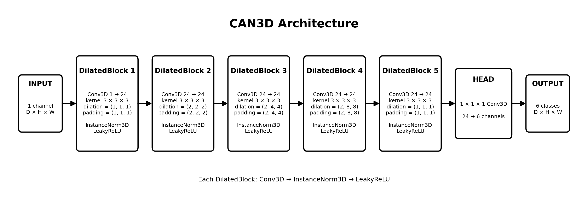

This Context Aggregation Network (CAN) is an advanced machine learning model that keeps the input data at full resolution, specifically designed for medical segmentation. In this repo, a CAN3D model is developed for 3D medical MRI scans of the hip of men to segment the skeleton, bladder, rectum, prostate, body and background. It will be compared to a simpler CAN2D model, and the pros and cons of using a more advanced 3D model vs the simpler 2D model will be discussed. The network consist primarily of a daisy chain of 'Dilation blocks'. Each of these blocks will perform convolution with dilation, normalization and then activation. Different dilations are used for the blocks throughout the network to increase the receptive field, while balancing fine detail. The 'Context Aggregation' part of the network means that it continously aggregates more and more complex geometry in the feature maps. The network width in this example is set to 24, meaning 24 different feature maps. Lastly, a convolutional layer is used to group the internal featuremaps into the 6 different classes. LeakyRelu is used instead of regular Relu to avoid dead units. This is especially important with an architecture like this, where we have no skip connections and every gradient must pass through the whole network. It is quite a simple network while still providing remarkable results.

The model can be used to give a rough estimate of the segmentation of different organs and tissues, though this exact model is only tested on the 6 classes previously mentioned. It could speed up manual segmentation by medical personnell and increase existing datasets.

* The loss function uses Cross-Entropy for optimal discrete segmentation performance
* Dice-score is calculated on foreground classes to avoid falsely high model performance
* 3D augmentation with PyTorch is used for the 3D dataset to increase variation and avoid overfitting
* Uses one-hot encoding to avoid falsely ranking the order of different classes
* The Adam optimizer is used when updating weights in backpropagation
* The model is not tailored towards any specific class, exploiting the added context to better the performance

## The Dataset (and preprocessing)

* The 3D dataset, 256x256x128 NIfTI: [Labelled weekly MR images of the male pelvis](https://data.csiro.au/collection/csiro:51392v2).
* The 2D dataset, 256x128 (256x144) NIfTI: Provided by COMP3710 staff at UQ (access restricted to UQ students), or manually sliced from the 3D dataset.

The 3D dataset contains 38 patients with 3D MRI scans from several consecutive weeks, totaling 211 samples. The 2D dataset are extracted slices from these 3D volumes split along the coronal (front-back) plane. They are already split into 11460 for training 660 for validation and 540 for test, totaling 12660 samples. This leads to a lower validate / test split than a usual 60/20/20, meaning the following results are more indicative than conclusive. The 2D dataset does not contain the same patient in multiple splits. `dataset.py` therefore compares the patient ID of the 2D and 3D datasets and splits the 3D dataset in the same way. While most slices are 256x128, some are 256x144 so padding is added to the 2D dataset to ensure common resolution of 256x144.

**Both the 2D dataset and 3D dataset are scaled down to 1/2 size (the `--scale` parameter in `train.py`) to improve memory usage and training time.**
The intensity of the greyscale image is also normalized to a mean of 0, standard deviation of 1 before use. Additionally, the 3D dataset is augmented (flipped at random) and a 10% intensity adjustment and 10% intensity bias is applied during training to increase the variation in the dataset.

Below is the patient IDs of the pre-split 2D dataset, printed by `dataset.py`.
`train{'008', '019', '016', '020', '010', '011', '007', '012', '025', '032', '024', '027', '018', '026', '021', '013', '033', '006', '035', '030', '029', '015', '017', '022', '005', '023', '031', '004', '028', '009', '014'} val{'038', '039', '037', '036'} test{'040', '042', '041'}`

The following is the patient IDs of the split made by the 3D dataset, proving there is no leakage and that it perfectly reflects the same patient split as the 2D set.
`{'train': {'035', '013', '029', '024', '010', '007', '011', '031', '020', '021', '015', '017', '008', '025', '030', '014', '032', '016', '019', '005', '012', '033', '009', '004', '022', '026', '023', '027', '018', '028', '006'}, 'val': {'039', '036', '038', '037'}, 'test': {'042', '041', '040'}}`

This gives the following splits
| MODEL | TRAIN        | VALIDATE  | TEST      | TOTAL  |
| ----- | ------------ | --------- | --------- | ------ |
| CAN2D | 90.5%, 11460 | 5.2%, 660 | 4.2%, 540 | 12 660 |
| CAN3D | 90.5%, 191   | 5.2%, 11  | 4.3%, 9   | 211    |

## Reproducibility

### Dependencies

`torch ≥ 2.14.0` \
`numpy ≥ 1.26.4` \
`nibabel ≥ 5.4.2` \
`matplotlib ≥ 3.10.8` \
A requirements.txt is included

### Setting up the repository and virtual environment

```bash
git clone https://github.com/shakes76/PatternAnalysis-2026.git
cd PatternAnalysis-2026
git checkout topic-recognition
cd recognition/CAN3D_s5048803

conda create -n can3d python=3.12 -y
conda activate can3d
pip install -r requirements.txt
```

### Training the model

The model has been trained using the following command. The scaling factor indicates the scale of the data before it enters the network, and 0.5 is chosen to keep the training fast and light. Use `--batch` to set the batch size (CAN3D uses a batch size of 1 irrespective of this). More command-line arguments can be found in `train.py`.

```bash
python train.py --epochs 20 --scale 0.5 --model can3d --seed 16
```

or

```bash
python train.py --epochs 20 --scale 0.5 --model can2d --seed 16 --batch 16
```

for the 2D model.

Training has been done on a Nvidia A100 40GB GPU, while inference and prediction metrics are from a 16GB M2 Mac.
Note: The per-class dice is volatile after ~5 epochs for both models, but the loss keeps decreasing. This could be an early sign of overfitting, so no more than 20 epochs is used.

<p align="center">
  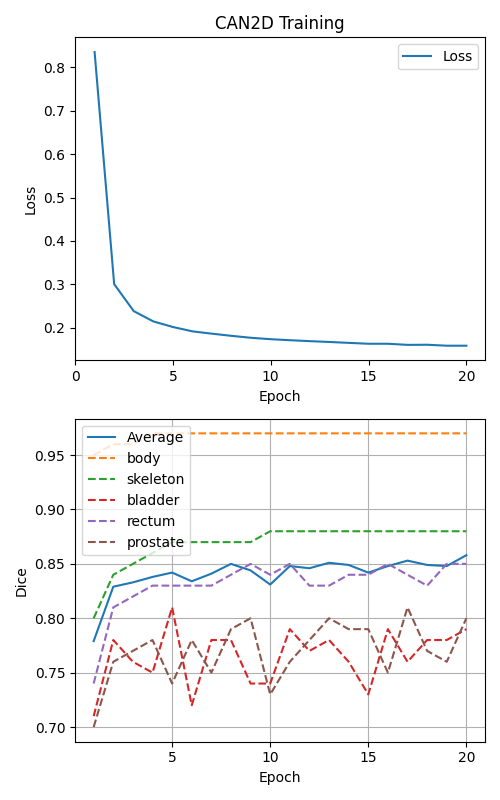
  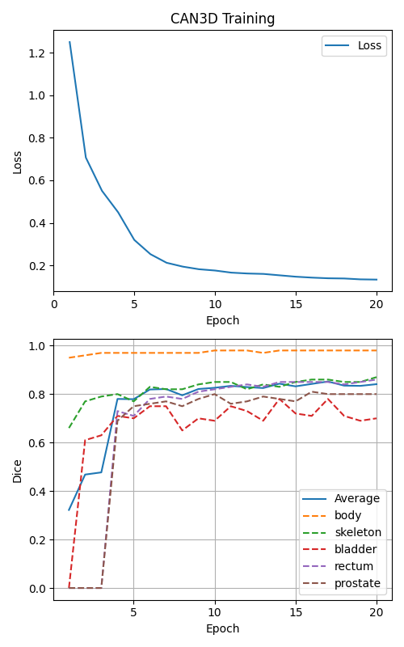
</p>

### Running inference

After obtaining the `can2d_best.pt` and `can3d_best.pt`, generate the model results by running:

```bash
python predict.py --weights2d models/can2d_best.pt --weights3d models/can3d_best.pt
```

This will measure inference runtime / memory, segment a complete MRI volume and print metrics among other things for both 2D and 3D models. The results are then placed in the `results` folder.

## Results

CAN3D segmenting along each of the three axis. It achieves a very good Dice score overall for the prostate. The class colors are:

* Prostate   -> Brown
* Skeleton   -> Green
* Bladder    -> Red
* Rectum     -> Purple
* Skin       -> Orange
* Background -> Blue

All metrics are computed per class from a confusion matrix pooled over every voxel in the
test set (so larger volumes weigh more than small ones). With TP, FP, FN per class:
Dice = 2TP / (2TP + FP + FN), IoU = TP / (TP + FP + FN),
over-contouring = 100\*FP / (TP + FN), under-contouring = 100\*FN / (TP + FN).

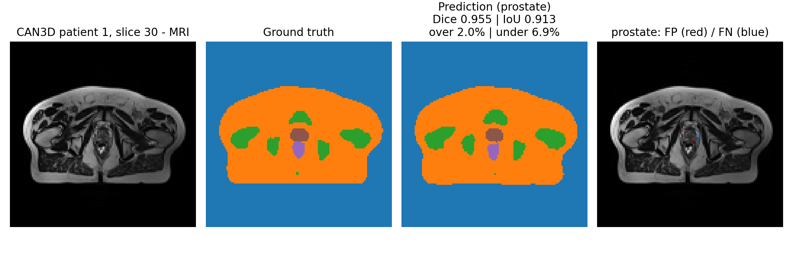
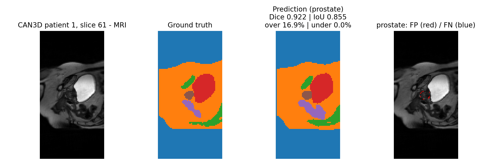
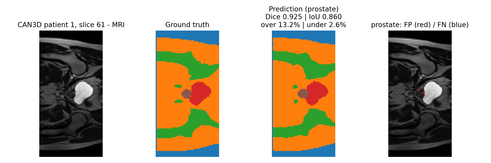

### Resource profiling

| MODEL | PARAMETERS | WIDTH | EPOCHS | TRAINING TIME | TRAIN MEMORY USAGE | INFERENCE TIME [ms] | INFERENCE MEMORY [MB] |
| ----- | ---------- | ----- | ------ | ------------- | ------------------ | ------------------- | --------------------- |
| CAN2D | 21 222     | 24    | 20     | 00:15:30      | 1743540K = 1.7GB   | 94.5 +/- 0.3        | 1131                  |
| CAN3D | 63 126     | 24    | 20     | 00:10:19      | 3384672K = 3.3GB   | 935.5 +/- 5.6       | 1155                  |

Note: Inference was run on a single 3D volume for CAN3D, while an equivalent amount of slices for the CAN2D,
a total of 10 times.

From the `predict.py` we get pooled metrics for both models. The pooled dice is also plotted and compared below. It is apparent that the two models perform almost the same.

```
Total parameters 3D: 63,126
CAN3D test, mean metrics:
      body: Dice 0.979  IoU 0.959  over 1.8%  under 2.4%
  skeleton: Dice 0.873  IoU 0.775  over 16.2%  under 9.9%
   bladder: Dice 0.942  IoU 0.891  over 8.5%  under 3.4%
    rectum: Dice 0.791  IoU 0.655  over 27.0%  under 16.9%
  prostate: Dice 0.864  IoU 0.761  over 16.7%  under 11.2%
  mean foreground: Dice 0.890  IoU 0.808

Total parameters 2D: 21,222
CAN2D test, mean metrics:
      body: Dice 0.977  IoU 0.954  over 2.2%  under 2.5%
  skeleton: Dice 0.897  IoU 0.814  over 10.6%  under 10.0%
   bladder: Dice 0.957  IoU 0.917  over 5.4%  under 3.4%
    rectum: Dice 0.824  IoU 0.701  over 21.4%  under 14.9%
  prostate: Dice 0.828  IoU 0.707  over 22.7%  under 13.3%
  mean foreground: Dice 0.897  IoU 0.819

Total parameters 3D: 63,126
CAN3D val, mean metrics:
      body: Dice 0.976  IoU 0.954  over 2.5%  under 2.2%
  skeleton: Dice 0.856  IoU 0.748  over 16.1%  under 13.2%
   bladder: Dice 0.780  IoU 0.639  over 6.8%  under 31.7%
    rectum: Dice 0.853  IoU 0.744  over 20.2%  under 10.6%
  prostate: Dice 0.797  IoU 0.662  over 15.4%  under 23.6%
  mean foreground: Dice 0.852  IoU 0.749

Total parameters 2D: 21,222
CAN2D val, mean metrics:
      body: Dice 0.971  IoU 0.943  over 3.8%  under 2.1%
  skeleton: Dice 0.881  IoU 0.788  over 9.1%  under 14.0%
   bladder: Dice 0.789  IoU 0.652  over 3.8%  under 32.4%
    rectum: Dice 0.847  IoU 0.734  over 16.0%  under 14.8%
  prostate: Dice 0.801  IoU 0.668  over 18.0%  under 21.2%
  mean foreground: Dice 0.858  IoU 0.757
```

The last two print segments is the metrics on the validation set. The validation sets mean foreground Dice value is almost equal the respective test set indicates that the models are not overfitting. The fact that they are high (≥ 0.7) means that the models are performing well.

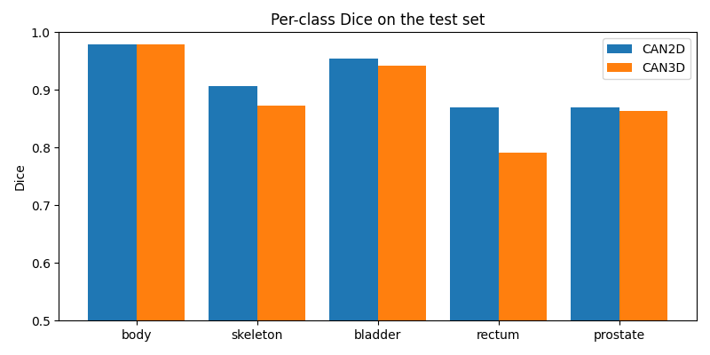

#### Slice metrics for volume 0 in test set

However, when we plot the different metrics layer by layer, we get a better picture of how each model performs at different depths in the MRI. Strict patient and layer matching is enforced to ensure comparable data. The prostate ground truth is the shaded central region. Overall, the Dice criteria of 0.7 or more is achieved by both models at almost every relevant slice.

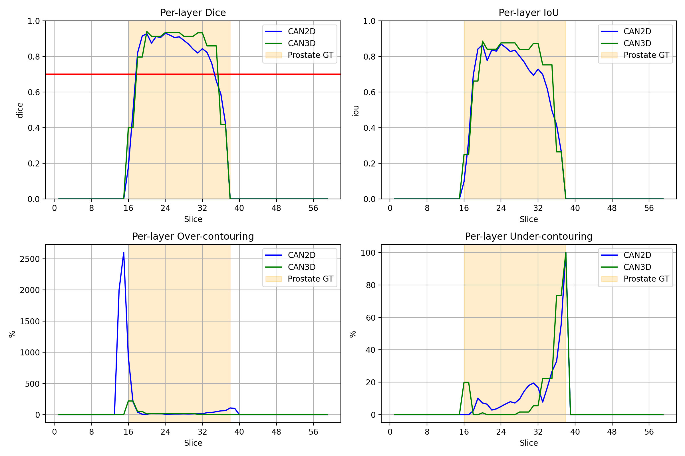

#### Slice metrics for volume 2 in test set

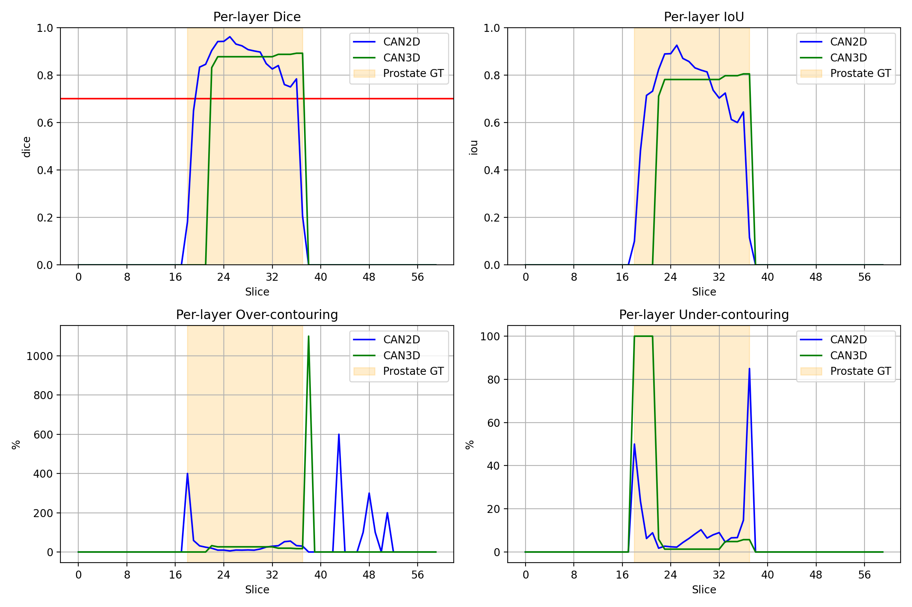
From this plot it is clear that the 2D model struggles to keep the spatial continuity, and occasionally detects a prostate far outside it's anatomical region. The Dice score of the CAN3D model seems overall more stable, though both models taper off at the ends of the prostate.

### Failure cases

For reference, a normal slice looks like this:

Percentages are relative to the ground-truth area. Where ground-truth is absent, they are relative to one pixel.

#### Case 1: Small prostate (Over and under-contouring)

Where the GT holds only a handful of prostate pixels (5 for CAN3D slice 57), both models draw a blob several times larger and cover the true pixels completely
(CAN2D under 0%). CAN2D also predicts prostate on slices 14-15, before the GT prostate begins (~20-26 false pixels) in the [metrics through slices on volume 0](#slice-metrics-for-volume-0-in-test-set) figure. CAN3D shows no activity before slice 16.
On test volume 0 slice 17, the CAN2D model wrongfully over-contours the prostate by 925%.
On test volume 0 slice 57, the CAN3D model over-contours the prostate by 225%.
This is likely triggered by how small the prostate is around this area, aswell as the challenging section between the rectum and prostate. At 0.5 scale one pixel is 2 original voxels per axis, so the tip is only a few pixels wide. Also, the border between the bladder and rectum offer weak contrast, and is a challenging section that needs special attention from medical  personnell.
Part of this can be mitigated by increasing the scaling of the data before it enters the network. A class-weighted loss function could train the models to work better for the smaller prostate organ.

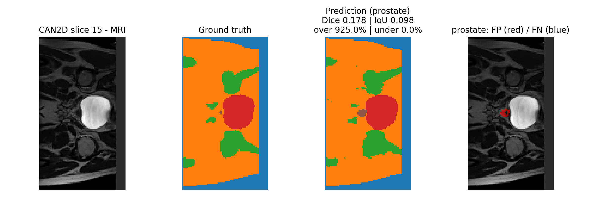
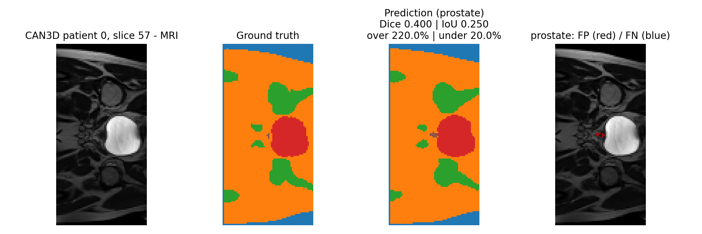

#### Case 2: Stray floating artifacts

For a given layer the CAN2D baseline model seems to be experiencing a lot more artifacts in its segmentation, than the CAN3D. While they both occasionally have a lone floating blob deep inside the wrong class, this happens more often to the 2D model (see [2d slices](./results/2d_slices/) and [3d slices](./results/3d_slices/)). The CAN2D also occasionally has perforated striations in large areas, that differ completely from layer to layer. A likely trigger of this is the CAN2D models' lesser spatial awareness in the 3rd dimension compared to the CAN3D model. While this does not directly happen as much to the prostate class, none of the models have any class preference, leading to it affecting all classes to some degree.
This effect could be mitigated by enforcing a minimum component size per class, or a post-filter that removes class predictions not connected.

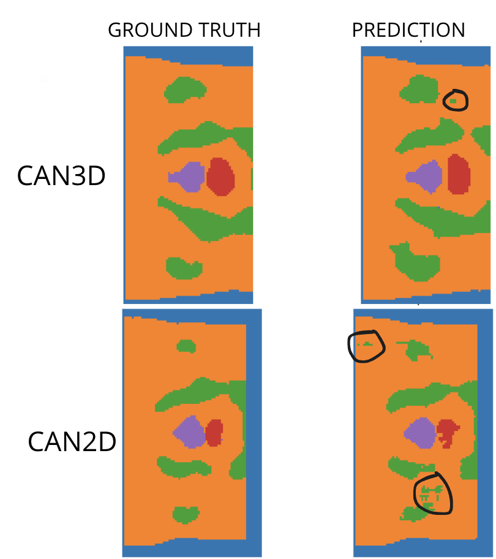

#### Case 3: Loss of spacial continuity

An extension of the previously mentioned artifacts is the smoothness of the edges of the segmentation. Below is an animation of the models results through the layers of the MRI scan. It is clear that the CAN3D model produces overall more smooth edges than the 2D, and has a better spacial continuity.

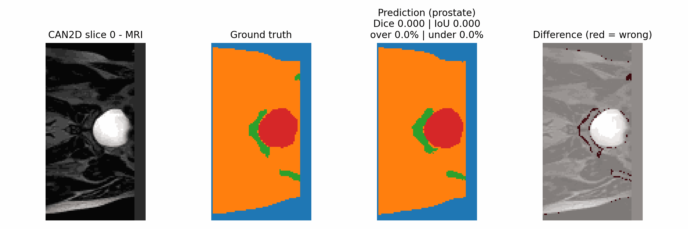
The cause of this is most likely that CAN2D predicts each slice independently, meaning small errors lead to discontinous slices. The CAN3D model takes the whole volume in consideration at once, meaning it better understands where an organ starts / stops. The jagged edges are also likely to come from the fact that CAN3D is a bigger network. With ~3x the parameters, it can represent a lot more complex structures than the lighter CAN2D. And when the CAN3D model produces more smooth edges, it naturally produces more accurate anatomical structures.

#### Case 4: Adjoined objects around the prostate

Adjoined objects would be when two or more classes get joined together and classified as one. This is not a severe problem for any of the models, possibly due to the one-hot encoding used. We clearly see both models classifying each separate class independently, at least in the central slices.

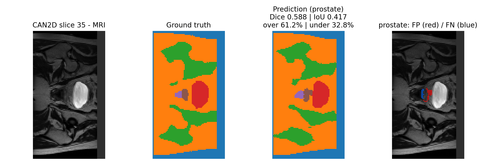
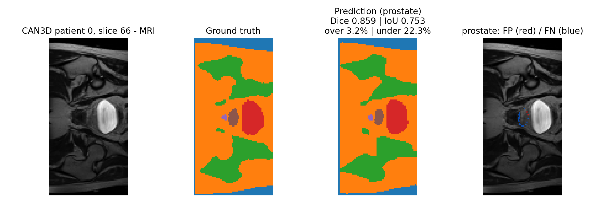

### Acceptance criteria

| Criterion                | Target                      | CAN2D              | CAN3D              | Met |
| ------------------------ | --------------------------- | ------------------ | ------------------ | --- |
| Dice, every class        | ≥ 0.75                     | min 0.824 (rectum) | min 0.791 (rectum) | Yes |
| Train/val Dice gap       | ≤ 0.1 (preferably ≤ 0.05) | 0.039              | 0.038              | Yes |
| Peak training VRAM       | < 40 GB                     | 1.7GB              | 3.3GB              | Yes |
| Peak inference memory    | ≤ 8 GB (max 16 GB)         | 1131 MB            | 1155 MB            | Yes |
| Inference time on M2 Mac | < 10 s                      | 0.095 s            | 0.94 s             | Yes |

## Recommendations

Pooled Dice is essentially equal (mean foreground 0.890 CAN3D vs 0.897 CAN2D), so the 3D context does not improve the easy, central slices much. The biggest benefit for the prostate is a Dice score of 0.864 vs 0.828, and over-contouring of 16.7% vs 22.7%. They both suffer from occasional stray artifacts, though the 2D model frequently segments perforated, impossible anatomical structures. These results come at a cost of 3x the parameters, 2x the training memory and ~10x the inference latency. I recommend to continue developing the CAN3D model and keeping the CAN2D as a fast baseline. With only 3 test patients, the dataset is limited and results should be treated as indicative, not conclusive.

**Cases not suitable for automatic drafting**

* The first and last 3-5 prostate slices, as the Dice score falls below 0.7 for both models
* The prostate / rectum interface, where rectum over-contouring is highest (27.0% CAN3D vs 21.4% CAN2D)

**Safeguards before clinical use**

* Keep only the largest connected component per class to remove stray blobs (not applicable to bones etc.)
* Review of slices with small prostate

**The next step**
Train at full resolution, and explore expanding the width of the network in certain dilation blocks so more complex structures can be represented. Expand the dataset to include more patients, ideally from other scanners or centres, to make the comparisons conclusive and test whether the models generalise on larger sets.

## Feasibility report

### User Need, Scope & Acceptance Criteria

This machine learning model is intended to give certified personnell a rough segmentation of the prostate in 2d and 3d MRI data. It could cut down time and cost of such work. Because of this its important that the model is fast and light to run. A baseline CAN2D model will work on individual slices while a CAN3D version will work on fully 3d MRI data. They will then be compared.
The a100 gpu used for training have about 40GB ram.

I'll specifically inspect these boundary failure cases:

* Adjoining objects around the prostate
* Stray floating artifacts (separated islands)
* Overcoverage / undercoverage
* Jagged edges

The acceptance criteria are:

* Overall Dice accuracy must be >= 0.75 for both 2D and 3D
* Peak VRAM must be < 40GB to fit on the A100 during training
* Peak inference memory <= 8GB preferably, absolute max 16GB to run on end-user hardware.
* Difference between train and validation Dice <= 0.1 to prevent overfitting on such a small dataset (preferably <= 0.05)
* Inference runs in <10 seconds on M2 mac

### Model Choice & Course Concepts

I'll be developing the CAN3D from [hard] difficulty, and compare it to a similar CAN2D model. The core architecture between the two will be the same, though the 3D version might need some different features later on in training to keep computing resources under control, and the dataloader will be different. The Context Aggregation Network will be a streamlined process through 'Dilation blocks'. Each of these blocks will perform convolution with dilation, normalization and then activation. Different dilations are used for each block to balance fine detail and wide context. An important feature with these dilation blocks is that the output dimension is the same as the input dimension. Lastly, a convolutional layer is used to group the internal featuremaps into the 6 different classes: Background, skin, skeleton, bladder, rectum and prostate.
LeakyRelu is used instead of regular Relu to avoid dead units. This is especially important with an architecture like this, where we have no skip connections and every gradient must pass through the whole network.
The train, test and validation datasets will be kept as similar as possible between the 2D and 3D models to give them as fair comparison as possible. The CAN3D: FAST 3D MEDICAL IMAGE SEGMENTATION VIA COMPACT CONTEXT AGGREGATION paper by Wei Dai and Shakes etc. will be useful.

### Preliminary Feasibility Evidence

The data: 38 patients. The 2D dataset is bigger because it has all the different slices of the patients while the 3D model treats the whole scan as a single input. The previously mentioned acceptance criteria is therefore very important to meet, since this is a small dataset.
The memory usage of the 3D model:
Kernel size = 3
Network width = 24
float32
Assuming a 2x downsampling (256x256x128 -> 128x128x64), the amount of parameters are:

3^3 * 1  * 24 + 24 = 672 parameters for initial block
3^3 * 24 * 24 + 24 = 15 576 parameters per central block (4)
1   * 24 * 6  + 6  = 150 parameters for final layer
Total = 63 126 parameters (252.5 KB)
The can3d_best.pt is 258KB, almost exactly this, and does not change with changing input resolution.

Activations:
24 * 64 * 128 * 128 * 4 bytes $\approx$ 100MB each layer
Each block has 3 layers, giving a rough model memory estimate of 1.6GB -> 2GB.
When running inference, about only one layer is active at once leading to as low as 1/16th -> 1/8th memory usage of training. The following tests ran with a 2x downsampling of the data, and shows we are well within the memory limit.
This gives headroom to increase the resolution of the data input aswell as the amount of layers in the model, if it performs better that way.

I ran a mock training of the CAN3D model with 15 epochs, and got the following from slurm:

| TYPE  | EPOCHS | TIME     | MEMORY USAGE   |
| ----- | ------ | -------- | -------------- |
| CAN3D | 15     | 00:07:43 | 3059388K = 3GB |

Results from running the CAN3D model on 4 samples. We clearly see the low resolution of the data, but the model shows
promising results considering this took less than 10min to train in only 15 epochs.

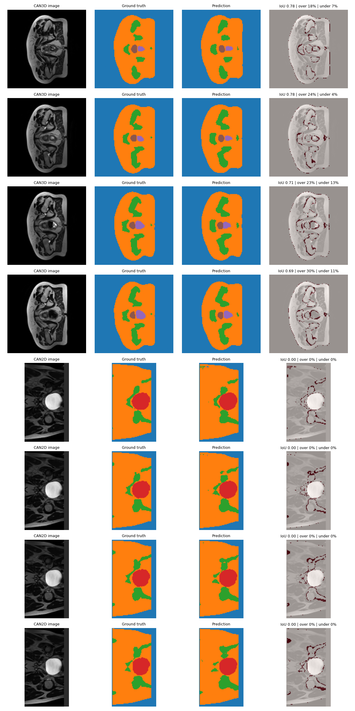

### Risks, Budget & Fallback

With this being a Context Aggregation Network (CAN), it keeps the input data at the same, high resolution all the way through the network. During training, this usually means it will use more RAM during training compared to U-NET for instance. It will also be challenging to balance its broad spatial awareness vs the fine detail accuracy. This will come down to tweaking the dilations for the different layers.

Furthermore, since the CAN2D and CAN3D architectures are very similar in design, it is paramount that they both work for this paper.
The initial training shows the architecture works, so if the data results are not sufficient a fallback would be to make it run on the OASIS brain dataset instead.
15 epochs took around 8 minutes, and i expect the full run to be around 100 epochs. With some headroom for the downsampling to be lessened I'm expecting training to take 1-2 hours on the A100 GPU. We have ~26 hours allocated on a dedicated lab computer.

The next experiment will be to compare the 2d and 3d results with eachother, and start to look at data proving whether or not the additional dimension is worth it. Also increasing the sample resolution while still staying inside the memory limits will be important to balance for the models usability and quality of output. I'd also like to generate a 3d plot of the prostate organ and compare it with the ground truth.

## Artificial Intelligence Usage Disclosure

Claude Sonnet 5.5 was used as an assistant in this project. It has been used to summarize and extract the most relevant information from
papers, especially reference 1 and the tasksheet. The core architecture, analysis and validation has been done by the author. Any AI generated code has been fully understood, modified and verified the functionality of before use. AI has been used in the `dataset.py` to find methods and help develop mock split functions to ensure equal training, test and validation sets for the 2D and 3D model.

## References

CAN3D: Fast 3D Medical Image Segmentation via Compact Context Aggregation, Wei Dai et al., 2021
