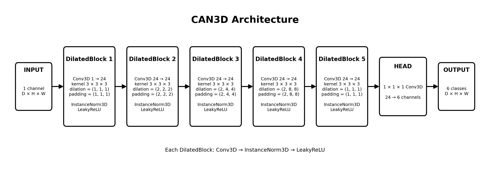
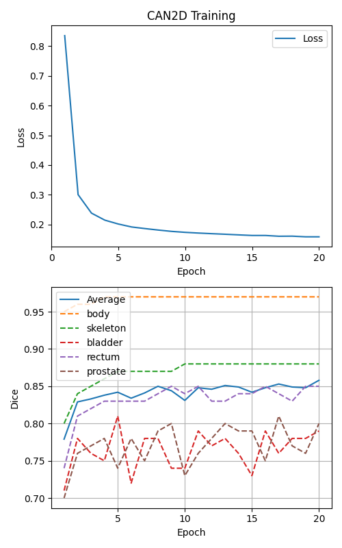
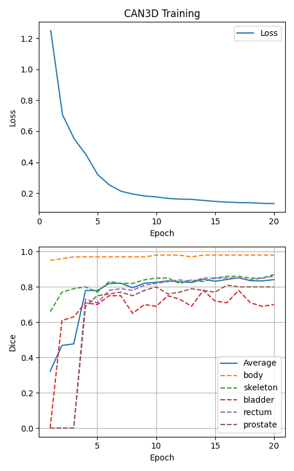
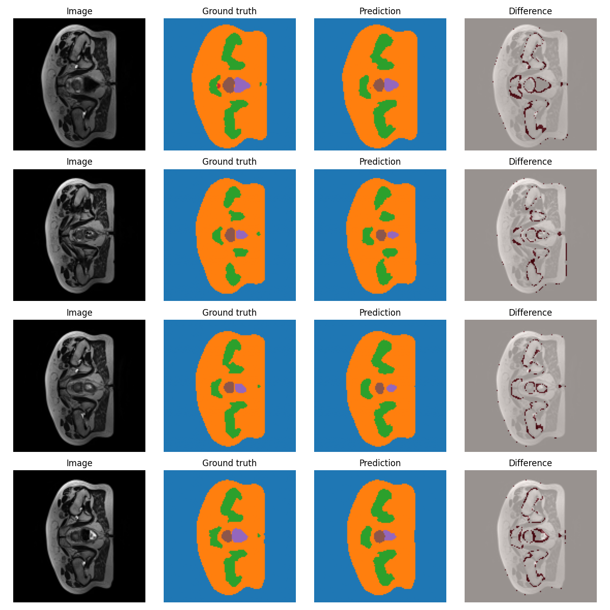

# CAN 3D Prostate Segmentation Model

Author: s5048803

## Folder structure
1. modules.py: Containing the source code of the components of your model. Each component must be
implemented as a class or a function in PyTorch or TensorFlow/Keras. Your implementation of the
model should not depend on NumPy (or other Python libraries not part of PyTorch / TensorFlow)
in any way unless otherwise approved by the teaching staff.
2. dataset.py: Containing the data loader for loading and preprocessing your data, including leakagefree train/validation/test splitting functions and data augmentations.
3. train.py: Containing the source code for training, validating, testing, and saving your model.
The model should be imported from modules.py and the data loader should be imported from
dataset.py. Make sure to plot the losses and metrics during training.
4. predict.py: Showing example usage of your trained model. It should load your saved model
weights, run inference on test cases, print out any results, and provide visualisations where applicable
(e.g., prediction overlays, generated samples, heatmaps). NumPy is allowed in this script for
visualization or loading data.
5. README.md: Sufficiently documenting your project, working principles, feasibility review, experiments,
and instructions (see Section 5.3).

## Algorithm description

A title, a description of the algorithm and the problem that it solves (approximately a paragraph),
how it works in a paragraph, and a figure/visualisation.

This Context Aggregation Network (CAN) is an advanced machine learning model that keeps the input data at full resolution, specifically designed for medical segmentation. In this repo, a CAN3D model is developed for 3D medical MRI scans of the hip of men to segment the skeleton, bladder, rectum, prostate, body and background. It will be compared to a simpler CAN2D model, and the pros and cons of using a more advanced 3D model vs the simpler 2D model will be discussed. The network consist primarily of a daisy chain of 'Dilation blocks'. Each of these blocks will perform convolution with dilation, normalization and then activation. Different dilations are used for the blocks throughout the network to increase the receptive field, while balancing fine detail. The 'Context Aggregation' part of the network means that it continously aggregates more and more complex geometry in the feature maps. The network width in this example is set to 24, meaning 24 different feature maps. Lastly, a convolutional layer is used to group the internal featuremaps into the 6 different classes. LeakyRelu is used instead of regular Relu to avoid dead units. This is especially important with an architecture like this, where we have no skip connections and every gradient must pass through the whole network. It is quite a simple network while still providing remarkable results. 

The model can be used to give a rough estimate of the segmentation of different organs and tissues, though this exact model is only tested on the 6 classes previously mentioned. It could speed up manual segmentation by medical personnell and increase existing datasets. 

## Dependencies

`torch >= 2.14.0` 
`torchvision >= 0.29.0` 
`numpy >= 1.26.4` 
`nibabel >= 5.4.2` 
`matplotlib >= 3.10.8` 
`tqdm >= 4.70.1` 
A requirements.txt is included

## Reproducibility

## Preparing the dataset

Description of any specific pre-processing used, with references if any. Justify your training,
validation, and testing splits of the data.
The 3D dataset contains 38 patients with 3D MRI scans from several consecutive weeks, totaling 211 samples. The 2D dataset has extracted 2D slices of this same dataset and is already split into 11460 for training 660 for validation and 540 for test, totaling 12660 samples. The 2D dataset does not contain a single patient in multiple splits. `dataset.py` therefore compares the patient ID of the 2D and 3D datasets and splits the 3D dataset in the same way, dropping the sample if it does not find a perfect match.

Below is the patient ids of the pre-split 2D dataset, taken from the `dataset.py`.
`train{'008', '019', '016', '020', '010', '011', '007', '012', '025', '032', '024', '027', '018', '026', '021', '013', '033', '006', '035', '030', '029', '015', '017', '022', '005', '023', '031', '004', '028', '009', '014'}
val{'038', '039', '037', '036'}
test{'040', '042', '041'}`

The following is the split made by the 3D dataset, proving there is no leakage and that it perfectly reflects the same patient split as the 2D set.
`{'train': {'035', '013', '029', '024', '010', '007', '011', '031', '020', '021', '015', '017', '008', '025', '030', '014', '032', '016', '019', '005', '012', '033', '009', '004', '022', '026', '023', '027', '018', '028', '006'}, 'val': {'039', '036', '038', '037'}, 'test': {'042', '041', '040'}}`

## Results

### Overcoverage / Undercoverage

### Small prostate
Investigate the over-contouring near the base of the prostate, the 2d performed way worse than 3d here no? like 900% overcontouring

### Stray floating artifacts

### 2d vs 3d results etc etc

Training has been done on a Nvidia A100 40GB GPU, while inference and prediction metrics are made on a 16GB M2 Mac.

### Resource profiling

Resource profiling table documenting computational efficiency (peak GPU VRAM, parameter
count, and inference runtime/latency).
| TYPE  | PARAMETERS | WIDTH | EPOCHS | TRAINING TIME | TRAIN MEMORY USAGE | INFERENCE TIME [ms] | INFERENCE MEMORY [MB] |
| ----- | ---------- | ----- | ------ | ------------- | ------------------ | ------------------- | --------------------- |
| CAN2D | 21 222     | 24    | 20     | 00:15:30      | 1743540K = 1.7GB   | 935.5 +/- 5.6       | 1131                  |
| CAN3D | 63 126     | 24    | 20     | 00:10:19      | 3384672K = 3.3GB   | 94.5 +/- 0.3        | 1155                  |

Note: Inference was run on a single 3D volume for CAN3D, while an equivalent amount of slices for the CAN2D,
a total of 10 times.

### Failure cases

 In-depth qualitative error autopsies analyzing 3–5 representative failure cases from the dataset
(diagnosing root triggers and failure modes).

### Recommendations

Actionable engineering recommendation and trade-off synthesis for your project manager.

jargon

## Notes

* The loss function uses Cross-Entropy for optimal discrete segmentation performance
* Dice-score is calculated on foreground classes to avoid falsely high model performance
* 3D Augmentation with PyTorch is used for the 3D dataset to increase variation and avoid overfitting
* Uses one-hot encoding to avoid falsely ranking the order of different classes
* Adam optimizer
* The model does not prefer a class over any other, exploiting the added context to better the performance

perhaps put each note under its relevant section:

DATASET:

* Pads necessary slices to every slice is 128x64 (some are 128x144)

## Feasibility report

### User Need, Scope & Acceptance Criteria

This machine learning model is intended to give certified personnell a rough segmentation of the prostate in 2d and 3d MRI data. It could cut down time and cost of such work. Because of this its important that the model is fast and light to run. A baseline CAN2D model will work on individual slices while a CAN3D version will work on fully 3d MRI data. They will then be compared.
The a100 gpu used for training have about 40GB ram. Running inference on a CAN model is usually lighter than a U-NET, meaning it's easier to run on end-user devices, making the model practical for real-world use.

I'll specifically inspect these boundary failure cases:

* Adjoining objects around the prostate
* Stray floating artifacts (separated islands)
* Overcoverage / undercoverage
* Jagged edges

The acceptance criteria are:

* Overall Dice accuracy must be >= 0.75 for both 2D and 3D
* Peak VRAM must be < 40GB to fit on the A100 during training
* Peak inference memory <= 8GB preferably, absolute max 16GB to run on end-user hardware.
* Difference between train and validation Dice <= 0.1 to prevent overfitting on such a small dataset (preferably <= 0.05)
* Inference runs in <10 seconds on M2 mac

### Model Choice & Course Concepts

I'll be developing the CAN3D from [hard] difficulty, and compare it to a similar CAN2D model. The core architecture between the two will be the same, though the 3D version might need some different features later on in training to keep computing resources under control, and the dataloader will be different. The Context Aggregation Network will be a streamlined process through 'Dilation blocks'. Each of these blocks will perform convolution with dilation, normalization and then activation. Different dilations are used for each block to balance fine detail and wide context. An important feature with these dilation blocks is that the output dimension is the same as the input dimension. Lastly, a convolutional layer is used to group the internal featuremaps into the 6 different classes: Background, skin, skeleton, bladder, rectum and prostate.
LeakyRelu is used instead of regular Relu to avoid dead units. This is especially important with an architecture like this, where we have no skip connections and every gradient must pass through the whole network.
The train, test and validation datasets will be kept as similar as possible between the 2D and 3D models to give them as fair comparison as possible. The CAN3D: FAST 3D MEDICAL IMAGE SEGMENTATION VIA COMPACT CONTEXT AGGREGATION paper by Wei Dai and Shakes etc. will be useful.

### Preliminary Feasibility Evidence

The data: 38 patients. The 2D dataset is bigger because it has all the different slices of the patients while the 3D model treats the whole scan as a single input. The previously mentioned acceptance criteria is therefore very important to meet, since this is a small dataset.
The memory usage of the 3D model:
Kernel size = 3
Network width = 24
float32
Assuming a 2x downsampling (256x256x128 -> 128x128x64), the amount of parameters are:

3^3 * 1  * 24 + 24 = 672 parameters for initial block
3^3 * 24 * 24 + 24 = 15 576 parameters per central block (4)
1   * 24 * 6  + 6  = 150 parameters for final layer
Total = 63 126 parameters (252.5 KB)
The can3d_best.pt is 258KB, almost exactly this, and does not change with changing input resolution.

Activations:
24 * 64 * 128 * 128 * 4 bytes $\approx$ 100MB each layer
Each block has 3 layers, giving a rough model memory estimate of 1.6GB -> 2GB.
When running inference, about only one layer is active at once leading to as low as 1/16th -> 1/8th memory usage of training. The following tests ran with a 2x downsampling of the data, and shows we are well within the memory limit.
This gives headroom to increase the resolution of the data input aswell as the amount of layers in the model, if it performs better that way.

I ran a mock training of the CAN3D model with 15 epochs, and got the following from slurm:

| TYPE  | EPOCHS | TIME     | MEMORY USAGE   |
| ----- | ------ | -------- | -------------- |
| CAN3D | 15     | 00:07:43 | 3059388K = 3GB |

Results from running the CAN3D model on 4 samples. We clearly see the low resolution of the data, but the model shows
promising results considering this took less than 10min to train in only 15 epochs.

### Risks, Budget & Fallback

With this being a Context Aggregation Network (CAN), it keeps the input data at the same, high resolution all the way through the network. During training, this usually means it will use more RAM during training compared to U-NET for instance. It will also be challenging to balance its broad spacial awareness vs the fine detail accuracy. This will come down to tweaking the dilations for the different layers.

Furthermore, since the CAN2D and CAN3D architectures are very similar in design, it is paramount that they both work for this paper.
The initial training shows the architecture works, so if the data results are not sufficient a fallback would be to make it run on the OASIS brain dataset instead.
15 epochs took around 8 minutes, and i expect the full run to be around 100 epochs. With some headroom for the downsampling to be lessened I'm expecting training to take 1-2 hours on the A100 GPU. We have ~26 hours allocated on a dedicated lab computer.

The next experiment will be to compare the 2d and 3d results with eachother, and start to look at data proving whether or not the additional dimension is worth it. Also increasing the sample resolution while still staying inside the memory limits will be important to balance for the models usability and quality of output. I'd also like to generate a 3d plot of the prostate organ and compare it with the ground truth.

## Artificial Intelligence Usage Disclosure

Claude Sonnet 5.5 was used as an assistant in this project. It has been used to summarize and extract the most relevant information from
papers, especially reference 1 and the tasksheet. The core architecture, analysis and validation has been done by the author. Any AI generated code has been fully understood, modified and verified the functionality of before use. AI has been used in the `dataset.py` to find methods and help develop mock split functions to ensure equal training, test and validation sets for the 2D and 3D model.

## References

CAN3D: Fast 3D Medical Image Segmentation via Compact Context Aggregation, Wei Dai et al., 2021

### FEEDBACK

* Plot per-slice difference between CAN2D and CAN3D segmentation (total area).
* Consider what the tradeoff between an overall low, but existing over/underfitting is vs a big spiked boundary.
* /\ /\ if this above is not good enough, you must find a good way to compare if the 3d version performs better than the 2d
* Ensure the test data that the predict runs on uses the exact same slices, otherwise the result could be misleading.
* Keep all the classes
* Calculate dice-score on a per-class basis
* The model predicts 6 classes, and is not biased towards any of them. The models performance will thus be reflected in the segmentation of every class.
  This means that the error between the ground truth and estimated segmentation for ALL classes is taken into account when evaluating each slice.
